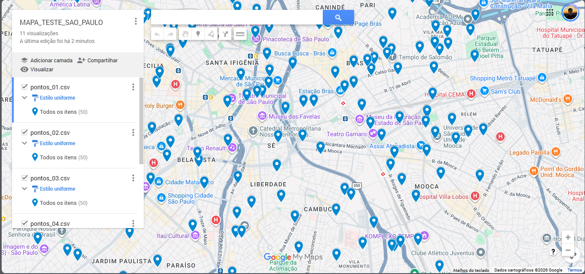

# auto-google-my-maps


Atualize pontos em **camadas existentes do Google My Maps** a partir de arquivos CSV locais. O projeto usa Python e Playwright para abrir o editor e executar **Atualizar itens correspondentes**, também chamado **Atualizar itens relacionados**.

O My Maps usa o ID de cada ponto para atualizar os itens correspondentes, adicionar novos e remover os que ficaram fora do CSV. A atualização mantém a camada existente e permite preservar estilos e fotos dos itens correspondentes. Comece com um mapa de teste e confira os efeitos antes de rodar o lote. [Ajuda do Google My Maps sobre reimportação](https://support.google.com/mymaps/answer/3024836?hl=pt-BR)



## 1. Instale o projeto

Você precisa de **Python 3.10 ou superior**, Git e uma sessão gráfica para abrir o navegador. Tenha uma conta Google com permissão para editar os mapas.

```bash
git clone --branch work https://github.com/lucasokwok/auto-google-my-maps.git
cd auto-google-my-maps
```

No **Prompt de Comando do Windows**:

```bat
python -m venv .venv
.venv\Scripts\activate.bat
```

No **macOS ou Linux**:

```bash
python3 -m venv .venv
source .venv/bin/activate
```

Com o ambiente ativo, instale o projeto a partir da raiz, a pasta que contém `pyproject.toml`:

```bash
python -m pip install -e ".[browser]"
```

O navegador padrão é o **Chromium do Playwright**. Se for usá-lo, instale o binário com `python -m playwright install chromium`. Se o Linux indicar bibliotecas ausentes, consulte a opção `python -m playwright install --with-deps chromium`. Se for usar `--navegador edge`, tenha o **Microsoft Edge instalado no computador**. [Navegadores do Playwright](https://playwright.dev/python/docs/browsers)

## 2. Prepare os mapas, as camadas e os CSVs

1. Abra cada mapa no modo de edição e prepare manualmente as camadas que receberão atualizações. Importe um CSV de base em cada uma para criar as colunas e preencher os IDs dos pontos existentes. Na importação inicial, selecione `Latitude` e `Longitude` para posicionar os pontos e `Nome` ou `ID` como título.
2. Dê a cada camada o **nome exato do CSV, com a extensão**. Para três camadas, use `pontos_01.csv`, `pontos_02.csv` e `pontos_03.csv`. O projeto aceita de uma a cinco camadas por mapa, sempre em sequência a partir de `pontos_01.csv`.
3. Crie uma pasta para cada mapa dentro de `MAPAS/`. O nome da pasta deve corresponder exatamente a `NomeMapa` na configuração. Guarde ali só os CSVs das camadas que quer atualizar. Deixe cópias de segurança fora dessa pasta.

**Todas as camadas e todos os CSVs dos mapas cadastrados precisam ter a coluna `ID`** com a configuração de exemplo. Se os seus dados usam outro nome, ajuste `coluna_identificacao` no JSON e use esse mesmo cabeçalho em todas as camadas e nos arquivos do lote.

| Requisito | Como preparar |
| --- | --- |
| ID | Preencha todos os IDs e mantenha-os únicos dentro de cada camada. Reuse o mesmo ID quando um ponto continuar no mapa, mesmo que sua posição ou seus atributos mudem. |
| Coordenadas | Use as colunas `Latitude` e `Longitude`, com ponto decimal. A latitude vai de −90 a 90 e a longitude de −180 a 180. |
| Formato | Salve como CSV separado por vírgulas em UTF-8, com ou sem BOM. Inclua o cabeçalho. Colunas adicionais, como `Nome`, podem ser usadas. |
| Limites por arquivo | De 1 a 2.000 registros e até 40 MB. |

Exemplo de `pontos_01.csv`:

```csv
ID,Latitude,Longitude,Nome
PONTO-001,-22.9068,-43.1729,Ponto de teste 1
PONTO-002,-22.9101,-43.1800,Ponto de teste 2
```

## 3. Cadastre os links de edição

Copie `config/mapas.example.json` para `config/mapas.json`. No Prompt de Comando do Windows, use `copy config\mapas.example.json config\mapas.json`. No macOS ou Linux, use `cp config/mapas.example.json config/mapas.json`.

Edite a cópia e deixe na lista apenas os mapas que deseja processar. Substitua a URL fictícia do exemplo pelo link HTTPS copiado da barra de endereços do editor do seu mapa. O link deve conter `/maps/d/edit` ou `/maps/d/u/<n>/edit` e um parâmetro `mid`.

```json
{
  "coluna_identificacao": "ID",
  "estrategia_reimportacao": "atualizar_correspondentes",
  "mapas": [
    {
      "NomeMapa": "MAPA_TESTE_RIO_DE_JANEIRO",
      "URL": "https://www.google.com/maps/d/edit?mid=SUBSTITUA_PELO_ID_DO_MAPA"
    }
  ]
}
```

A estrutura correspondente é:

```text
auto-google-my-maps/
├── config/
│   └── mapas.json
├── MAPAS/
│   └── MAPA_TESTE_RIO_DE_JANEIRO/
│       └── pontos_01.csv
└── pyproject.toml
```

Um mesmo mapa remoto deve aparecer uma única vez no cadastro. Se precisar usar outros caminhos locais, informe `--config` e `--mapas-dir` aos comandos de validação e atualização. [Detalhes do cadastro](config/README.md) · [Regras dos CSVs](MAPAS/README.md)

## 4. Faça login e salve a sessão

A autenticação é manual. O navegador guarda a sessão em um perfil local persistente, e as próximas execuções reutilizam esse perfil. Use o mesmo navegador e, se definir um caminho próprio, o mesmo `--perfil-dir` em `login` e `atualizar`. Deixe o perfil em um diretório local persistente e use um processo por perfil de cada vez.

Para entrar com o Chromium:

```bash
python -m auto_googlemymaps login
```

Na janela que abrir, entre na conta Google que tem acesso de edição, conclua as verificações solicitadas e volte ao terminal. Quando a página **Minha Conta** estiver autenticada, pressione **Enter**. A mensagem `Login Google confirmado. Perfil salvo localmente.` confirma que o aplicativo conseguiu acessar a conta.

O perfil padrão é `runtime/google_profile/` no Chromium e `runtime/google_profile_edge/` com `--navegador edge`. Se a sessão expirar, repita o login com o mesmo perfil.

### Login confirmado com o Edge no Windows

Se o Google recusar o login no navegador aberto pelo Playwright com **Esse navegador ou app pode não ser seguro**, abra o Edge diretamente com um perfil dedicado. Esse processo foi testado no Windows. Execute os comandos abaixo no **Prompt de Comando**:

```bat
set "PERFIL_MYMAPS=%LOCALAPPDATA%\auto-google-my-maps\edge-profile"
start "" "%ProgramFiles(x86)%\Microsoft\Edge\Application\msedge.exe" --user-data-dir="%PERFIL_MYMAPS%" "https://myaccount.google.com/"
```

Se o Edge estiver instalado em outro caminho, ajuste somente o caminho de `msedge.exe`. Entre manualmente na conta, feche todas as janelas que usam esse perfil e retorne ao terminal:

```bat
python -m auto_googlemymaps login --navegador edge --perfil-dir "%PERFIL_MYMAPS%"
```

Quando a página **Minha Conta** abrir autenticada, pressione **Enter** para confirmar. Use esse mesmo diretório nas atualizações. Se abrir outro Prompt de Comando, repita a linha `set` para disponibilizar a variável nesse terminal. [Detalhes do perfil no Edge](docs/PLAYWRIGHT.md#sessão-dedicada-no-edge-do-windows)

## 5. Valide e atualize

A partir da raiz do repositório:

```bash
python -m auto_googlemymaps validar
python -m auto_googlemymaps planejar
```

`validar` confere o cadastro, as pastas e os CSVs. `planejar` também mostra os nomes das camadas e a contagem de registros. Ambos funcionam sem abrir o navegador. Corrija as falhas de validação antes de testar a atualização.

**Primeiro teste.** Se importou o CSV de exemplo, substitua as linhas de dados do arquivo local pelas do bloco abaixo. O teste altera `PONTO-001`, remove `PONTO-002` e adiciona `PONTO-003`. Confira em `planejar` se a camada esperada aparece com 2 registros e atualize apenas esse mapa.

```csv
ID,Latitude,Longitude,Nome
PONTO-001,-22.9070,-43.1729,Ponto de teste 1 atualizado
PONTO-003,-22.8990,-43.1750,Ponto de teste 3
```

Com o **Chromium**:

```bash
python -m auto_googlemymaps atualizar --mapa MAPA_TESTE_RIO_DE_JANEIRO
```

Com o **Edge e o perfil dedicado**:

```bat
set "PERFIL_MYMAPS=%LOCALAPPDATA%\auto-google-my-maps\edge-profile"
python -m auto_googlemymaps atualizar --navegador edge --perfil-dir "%PERFIL_MYMAPS%" --mapa MAPA_TESTE_RIO_DE_JANEIRO
```

Procure **atualização confirmada pela interface** no terminal ou em `logs/atualizacao.log`. Reabra o mapa e confira o ponto alterado, o incluído e o removido pelos IDs. Para atualizar **todos os mapas cadastrados**, execute o mesmo comando retirando `--mapa` e o nome.

### Agende a atualização no Windows

#### Configure a cópia local do `.bat`

Com a sessão do Edge já salva, abra o **Prompt de Comando** na raiz do repositório e crie uma cópia do modelo. Edite sempre a cópia `atualizar-mymaps.bat`, que o Git ignora. [Arquivo de exemplo](atualizar-mymaps.example.bat)

```bat
copy atualizar-mymaps.example.bat atualizar-mymaps.bat
notepad atualizar-mymaps.bat
```

- **`PROJETO`** — mantenha `set "PROJETO=%~dp0"` se a cópia estiver na raiz do projeto. Se mover o arquivo para outra pasta, informe o caminho absoluto da pasta que contém `pyproject.toml`, por exemplo `set "PROJETO=C:\Projetos\auto-google-my-maps"`.
- **`PERFIL_MYMAPS`** — use o mesmo diretório que você passou a `login --navegador edge --perfil-dir`. O modelo usa `%LOCALAPPDATA%\auto-google-my-maps\edge-profile`. Se salvou a sessão em outro diretório, substitua o valor completo, por exemplo `set "PERFIL_MYMAPS=D:\Perfis\edge-mymaps"`. Mantenha as aspas.
- **Mapas** — o comando usa o Python de `.venv` e atualiza todos os mapas cadastrados. Para testar com um único mapa, acrescente `--mapa "MAPA_TESTE_RIO_DE_JANEIRO"` ao fim da linha que começa com `".venv\Scripts\python.exe"`. Use o `NomeMapa` exato e retire a opção quando quiser rodar o lote.

Salve a cópia, feche as janelas que usarem o perfil dedicado e execute `atualizar-mymaps.bat` no Prompt de Comando para testar os caminhos e a sessão. Reserve `--pausar-em-erro` para execuções manuais que tenham alguém no terminal para pressionar **Enter**.

#### Cadastre a tarefa

Abra o **Agendador de Tarefas** no menu Iniciar, escolha **Criar Tarefa** e preencha as abas.

| Aba | Configuração |
| --- | --- |
| **Geral** | Dê um nome à tarefa, como **Atualizar Google My Maps**. Use a mesma conta do Windows que fez login no Edge e selecione **Executar somente quando o usuário estiver conectado**. |
| **Disparadores** | Clique em **Novo**. Selecione **Em um agendamento** e defina a frequência e o horário para depois de os CSVs estarem disponíveis. |
| **Ações** | Clique em **Novo**, escolha **Iniciar um programa** e preencha os campos abaixo. |
| **Configurações** | Em **Se a tarefa já estiver em execução**, escolha **Não iniciar uma nova instância**. |

| Campo da ação | Valor |
| --- | --- |
| **Programa/script** | `C:\Windows\System32\cmd.exe` |
| **Adicionar argumentos** | `/d /c ""C:\Projetos\auto-google-my-maps\atualizar-mymaps.bat""` |
| **Iniciar em** | `C:\Projetos\auto-google-my-maps` |

Substitua o caminho de exemplo em **Adicionar argumentos** pelo caminho completo da cópia e preserve as aspas duplas. Em **Iniciar em**, informe o caminho da pasta do projeto, sem aspas. Clique em **OK** para salvar.

#### Confirme a primeira execução

Feche as janelas que usarem o perfil dedicado. Na **Biblioteca do Agendador de Tarefas**, encontre a tarefa, clique nela com o botão direito e escolha **Executar**. Quando terminar, confira **Resultado da última execução** e `logs/atualizacao.log` na raiz do projeto. `0x0` indica sucesso. Se o log indicar sessão expirada, renove o login manualmente no mesmo perfil.

## 6. Entenda as alternativas de upload e os erros

No envio padrão, o Playwright espera 2 segundos após localizar o campo de arquivo e entrega o CSV original. Se o campo esperado estiver ausente, tenta o botão **Procurar**. Se precisar testar outra forma de envio, acrescente `--arrastar-csv` ao comando para usar a área de arrastar e soltar do seletor.

| Situação | O que acontece |
| --- | --- |
| Pasta, sequência ou CSV inválido | O programa registra o erro e pula aquele mapa. Corrija o arquivo e rode `validar` novamente. |
| Camada ausente, ambígua ou com nome diferente do arquivo | O programa registra a falha daquela camada. Confira o nome exato no editor e a existência de um único menu associado à camada. |
| Tempo esgotado antes da entrega, falha temporária de rede ou seletor aberto por 60 segundos após a entrega | O programa pode repetir o upload uma vez em uma página nova. Uma recusa de acesso, um limite de requisições ou um pedido de espera, quando reconhecidos, bloqueiam a retentativa. |
| **Sua última ação foi revertida** após **Concluir** | O programa reabre o mapa após 2 segundos e tenta a mesma camada. O limite por camada é de cinco retentativas, incluindo uma eventual retentativa de upload. Depois do limite, registra a falha e segue para as demais. |
| **Resultado indeterminado** após **Concluir** | Confira a camada no editor antes de repetir. A alteração pode ter sido aplicada mesmo sem o aviso de sucesso. |
| Sessão ausente, expirada ou verificação de segurança | O programa interrompe o lote. Renove a sessão manualmente com o mesmo perfil e confira a última camada processada antes de retomar. |

Para ver a tela da falha, acrescente `--pausar-em-erro`. A página fica aberta até você pressionar **Enter** no terminal. Use **Ctrl+C** para interromper a execução. Avisos temporários podem desaparecer enquanto a página está aberta.

O resumo no terminal e em `logs/atualizacao.log` indica o mapa, a camada e o total confirmado. O código de saída é `0` para sucesso, `1` para falha de operação ou de validação dos CSVs, `2` para erro de configuração, uso ou abertura do log e `130` para interrupção pelo usuário. O lote processa cada camada separadamente, com confirmação pela interface do My Maps. Mudanças na interface podem afetar a automação. [Como o Playwright confirma a atualização](docs/PLAYWRIGHT.md)

## Privacidade e testes

Mantenha os links de edição reais em `config/mapas.json` e os dados dos mapas nas pastas locais. O Git ignora os CSVs, a configuração privada, os logs e as pastas de sessão padrão. Se escolher outro caminho com `--perfil-dir`, mantenha-o fora do repositório. Antes de compartilhar um log ou uma captura, confira se os nomes dos mapas e dados dos pontos podem ser divulgados. [Segurança e privacidade](docs/SEGURANCA.md)

Para rodar a suíte com arquivos fictícios e mocks do Playwright:

```bash
python -m pip install -e ".[browser,dev]"
python -m pytest -q
```

[Arquitetura](docs/ARQUITETURA.md) · [Integração com Playwright](docs/PLAYWRIGHT.md) · [Licença MIT](LICENSE)
